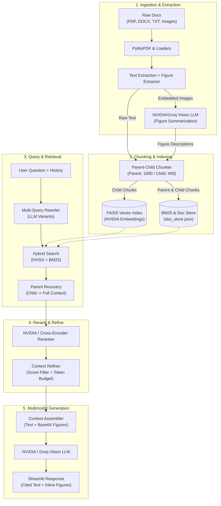

# 📚 Multimodal Advanced RAG Assistant

<p align="center">
  
  
  
  
  
  
  
  
</p>

<p align="center">
  <strong>A production-grade, multimodal Retrieval-Augmented Generation (RAG) assistant that reasons over text, tables, charts, and diagrams from your documents with full citations and inline visual evidence.</strong>
</p>

<p align="center">
  <a href="https://multimodal-advanced-rag.streamlit.app/">
    
  </a>
</p>

<p align="center">
  **Live App:** [https://multimodal-advanced-rag.streamlit.app/](https://multimodal-advanced-rag.streamlit.app/)
</p>

---

## 🌟 Highlights

- 🖼️ **Multimodal Figure Understanding**: Automatically detects and extracts charts, diagrams, and figures from PDFs (and standalone images). Uses a vision LLM to generate rich semantic summaries so visual data is as searchable as text.
- ⚡ **100% Free-Tier Architecture**: Built using free API tiers from **NVIDIA NIM** (vision, embeddings, reranking) and **Groq** (ultra-fast inference backup) — zero cloud GPU costs required.
- 🔍 **Hybrid Retrieval**: Combines semantic dense retrieval (FAISS) with lexical keyword matching (BM25) to catch both high-level concepts and exact domain keywords.
- 🔄 **Multi-Query Rewriting**: Dynamically expands user questions into multiple search queries while resolving pronoun ambiguity using chat history.
- 📐 **Hierarchical Parent-Child Chunking**: Indexes small, focused child chunks (400 chars) for precision search, while supplying broad parent chunks (1600 chars) to the LLM for deep context.
- 🎯 **Deep Reranking**: Re-scores candidate documents using cross-encoders / NVIDIA NIM rerankers with automatic fallback to keyword overlap.
- 📑 **Inline Citations & Visual Artifacts**: Text answers reference sources via numbered citations (`[1]`), and relevant charts/figures are rendered directly inside the chat interface.
- 🔬 **Retrieval Debug Inspector**: Inspect intermediate steps — multi-query variants, hybrid retrieval candidates, reranking scores, and prompt budgets in real time.
- ☁️ **Deployed on Streamlit Community Cloud**: Try the live application in your browser. The app supports isolated visitor workspaces with automatic cleanup of idle sessions.

---

## 🏗️ Architecture & Pipeline Flow



---

## 🧰 Tech Stack

| Component | Technology | Role |
| :--- | :--- | :--- |
| **Primary LLM & Vision** | **NVIDIA NIM** (`meta/llama-3.2-11b-vision-instruct` / `nemotron`) | Vision figure description & contextual answer generation |
| **Failover LLM** | **Groq** (`llama-3.2-11b-vision-preview` / `llama-3.3-70b-versatile`) | High-speed backup for answer synthesis |
| **Embeddings** | **NVIDIA NIM** (`nvidia/nv-embedqa-e5-v5` / `nemotron-3-embed-1b`) | High-dimensional semantic embeddings |
| **Reranker** | **NVIDIA Reranking NIM** / Local Cross-Encoder | High-precision candidate relevance re-scoring |
| **Dense Vector Index** | **FAISS** (Local CPU) | Fast, lightweight local vector search |
| **Sparse Lexical Index** | **BM25** (`rank-bm25`) | Exact keyword and terminology matching |
| **Document Processing** | **PyMuPDF (`fitz`)**, **Docx2txt**, **Pillow** | Text parsing and high-resolution figure extraction |
| **Orchestration** | **LangChain Core & Community** | Prompt chaining, memory management, and pipeline flow |
| **User Interface** | **Streamlit** (1.50+) | Interactive multi-turn chat, file manager, and debug console |

---

## 📂 Project Structure

```text
Advanced RAG/
├── app.py                            # Streamlit user interface & chat session controller
├── config.py                         # Central configuration, hyperparameters & env validation
├── llm_client.py                     # Unified client for NVIDIA NIM & Groq models
├── requirements.txt                  # Python dependencies
├── .env.example                      # Template for API keys and configuration
├── README.md                         # Project documentation
│
├── data/
│   ├── documents/                    # Default source documents (PDF, DOCX, TXT, images)
│   └── extracted_images/             # Figures extracted from uploaded documents
│
├── vectorstore/
│   ├── faiss/                        # Local FAISS index files (index.faiss, index.pkl)
│   ├── doc_store.json                # Complete parent/child chunk store for BM25 & lookup
│   └── image_descriptions.json       # Cache of vision model figure descriptions
│
├── src/                              # Core RAG implementation modules
│   ├── __init__.py                   # Package exports
│   ├── ingestion.py                  # Multi-format loaders & PDF figure extraction
│   ├── chunking.py                   # Parent-child chunking & image-to-document mapping
│   ├── indexing.py                   # FAISS vector store creation & incremental indexing
│   ├── retrieval.py                  # Multi-query rewriting, hybrid retrieval & parent recovery
│   ├── reranking.py                  # NVIDIA NIM & cross-encoder rerankers with fallbacks
│   ├── refinement.py                 # Irrelevance filtering, context budgeting & citations
│   ├── rag_pipeline.py               # End-to-end pipeline execution & answer generation
│   ├── memory.py                     # Sliding-window conversation history
│   ├── paths.py                      # Robust cross-platform path resolution for visual figures
│   └── workspace.py                  # Session-isolated workspaces for hosted multi-user environments
│
├── scripts/                          # Utility & validation scripts
│   ├── check_models.py               # Validates API keys, model endpoints & reranker connectivity
│   ├── build_index.py                # Standalone CLI script to build vector index
│   └── generate_sample_documents.py  # Generates synthetic test documents with charts
│
└── tests/
    └── test_offline.py               # Comprehensive offline test suite (no API keys needed)
```

---

## 🚀 Quickstart Guide

### 1. Prerequisites
- **Python**: Version 3.10 or higher
- **NVIDIA API Key**: Free tier from [build.nvidia.com](https://build.nvidia.com)
- **Groq API Key** *(Optional)*: Free tier from [console.groq.com](https://console.groq.com)

### 2. Installation

Clone the repository and set up a Python virtual environment:

```bash
# Clone repository
git clone https://github.com/your-username/multimodal-advanced-rag.git
cd multimodal-advanced-rag

# Create and activate virtual environment
python -m venv myenv

# Windows
myenv\Scripts\activate

# Linux / macOS
source myenv/bin/activate

# Install dependencies
pip install -r requirements.txt
```

### 3. Environment Configuration

Copy the example environment file and configure your credentials:

```bash
cp .env.example .env
```

Open `.env` in your editor and add your keys:

```dotenv
# Primary Provider: NVIDIA NIM (Free API keys at build.nvidia.com)
NVIDIA_API_KEY=nvapi-your-key-here

# Optional: Groq Backup
GROQ_API_KEY=gsk_your-groq-key-here

# Vector Store Engine ("faiss" or "pinecone")
VECTOR_DB=faiss

# Reranker Engine ("nvidia", "cross-encoder", or "simple")
RERANKER=nvidia
```

### 4. Verify Your Setup

Run the built-in diagnostic tool to test your endpoints, keys, and model response times:

```bash
python scripts/check_models.py
```

*Expected output:*
```text
[PASS] NVIDIA API Key: valid format
[PASS] Chat Model (meta/llama-3.2-11b-vision-instruct): responding
[PASS] Embedding Model (nvidia/nv-embedqa-e5-v5): vectors generated
[PASS] Reranker Endpoint: online
All checks passed! System ready.
```

### 5. Launch the Web Application

```bash
streamlit run app.py
```

Open your browser at `http://localhost:8501`.

---

## 🖥️ User Interface Walkthrough

```text
┌───────────────────────────────────────────────┬───────────────────────────────────────────────┐
│  SIDEBAR: CONTROLS & STATUS                   │  CHAT INTERFACE                               │
│                                               │                                               │
│  📂 Upload Documents & Images                 │  User: How did operating margins change in    │
│     [Drop PDF, DOCX, TXT, PNG, JPG here]     │        Q3, and what does the chart show?      │
│     [Save Files]  [Build Vector DB]           │                                               │
│                                               │  Assistant: Operating margins expanded by     │
│  ⚙️ Pipeline Configuration                     │  2.4% due to reduced COGS [1]. As shown in    │
│     • Vector DB: FAISS                        │  the breakdown below, software margins        │
│     • Models: NVIDIA NIM                      │  reached 78% [Figure 1: page 4 of report.pdf].│
│     • Status: Index Ready (14 Chunks, 2 Figs) │                                               │
│                                               │  ┌─────────────────────────────────────────┐  │
│  🔍 Debugging                                 │  │ [Image Preview: Q3 Margin Breakdown]   │  │
│     [x] Show Retrieval Details                │  └─────────────────────────────────────────┘  │
│                                               │                                               │
│  🧹 Session                                   │  Sources:                                     │
│     [Clear Chat]   [Clear Index]              │  [1] report.pdf - Page 3                      │
│                                               │  [Figure 1] report.pdf - Page 4 (Extracted)   │
└───────────────────────────────────────────────┴───────────────────────────────────────────────┘
```

1. **Upload Documents**: Upload one or more PDF, DOCX, TXT files or images.
2. **Build Index**: Click **Build Vector DB**. Figures are extracted from PDFs, analyzed via Vision LLM, and embedded into FAISS.
3. **Ask Questions**: Ask questions referring to text or visual figures. Answers will display source citations and inline figure images.
4. **Inspect Retrieval**: Toggle **Show Retrieval Details** in the sidebar to review:
   - Generated Multi-Query variants.
   - Raw hybrid retrieval scores (FAISS vs BM25).
   - Cross-encoder reranked candidate ordering.
   - Exact context payload sent to the Vision LLM.

---

## 🧪 Testing & Validation

The project includes an **offline test suite** that validates core pipeline logic without making external API calls or requiring internet connectivity:

```bash
python -m pytest tests -q
```

Tests cover:
- Document loaders and PDF figure extraction.
- Parent-child chunk linkage and metadata consistency.
- Citation formatting and character budget trimming.
- Fallback reranking behavior under failure conditions.
- Path resolution across varied operating systems.

---

## ☁️ Live Deployment (Streamlit Community Cloud)

The application is published on **Streamlit Community Cloud**:

<p align="center">
  <a href="https://multimodal-advanced-rag.streamlit.app/">
    
  </a>
</p>

**[Open the live application](https://multimodal-advanced-rag.streamlit.app/)**

### Deployment configuration

If you are deploying your own copy:

1. Push the project to a GitHub repository.
2. Sign in to [Streamlit Community Cloud](https://share.streamlit.io/) and create an app from that repository.
3. Select the deployment branch and set the main file path to `app.py`.
4. Open the app's **Settings → Secrets** and add your API keys and workspace setting:

   ```toml
   NVIDIA_API_KEY = "your-nvidia-api-key"
   GROQ_API_KEY = "your-groq-api-key" # Optional
   PER_SESSION_WORKSPACES = true
   ```

5. Save the secrets. Streamlit Cloud will restart the app with the updated configuration.

The app creates a separate workspace for each visitor when `PER_SESSION_WORKSPACES` is enabled. Uploaded files and FAISS indexes are stored on the app's local filesystem, so they should be treated as temporary on Streamlit Community Cloud and may not survive restarts or redeployments.

---

## ⚖️ Limitations & Best Practices

- **Rate Limits**: Free tier APIs carry per-minute RPM limits. If limits are reached, the system will fall back gracefully to the simple reranker.
- **Complex Diagrams**: Highly dense circuit diagrams or fine-print tables may benefit from higher-resolution vision models.
- **Local FAISS Storage**: FAISS runs locally on CPU. For enterprise production scale with millions of documents, set `VECTOR_DB=pinecone` in `.env`.

---

## 📄 License

Distributed under the **MIT License**. See `LICENSE` for more information.

---

<p align="center">
  Built with ❤️ for advanced RAG research and multimodal application development.
</p>
